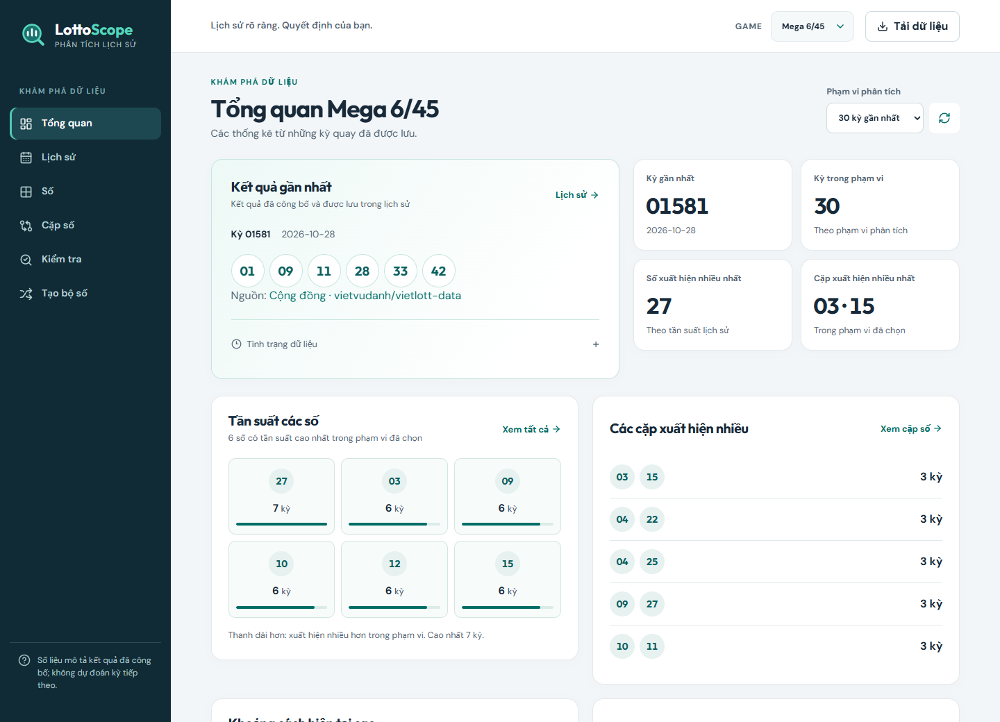
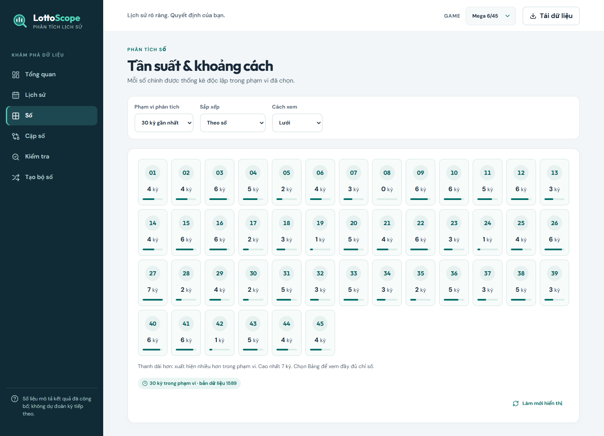
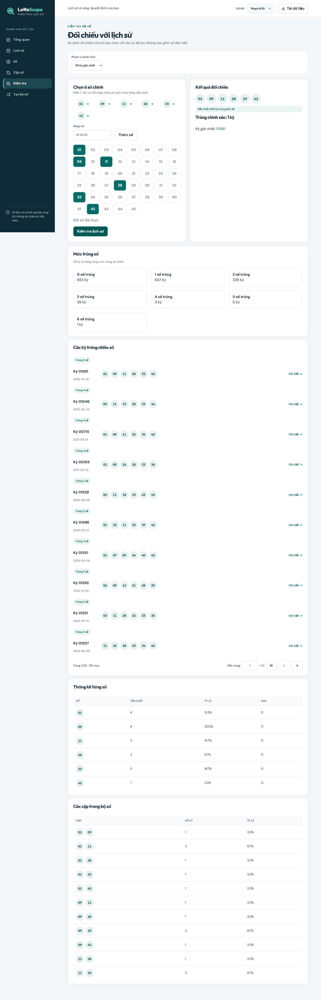
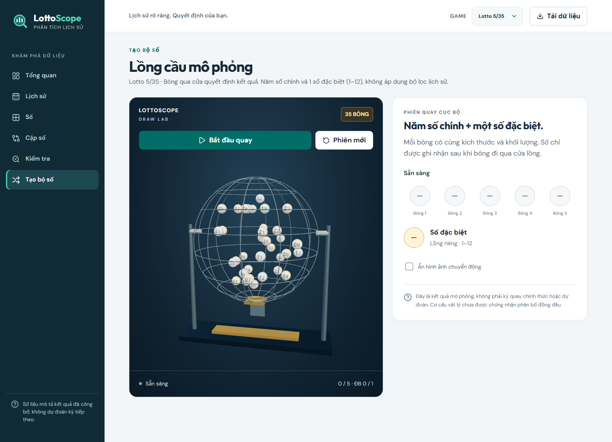
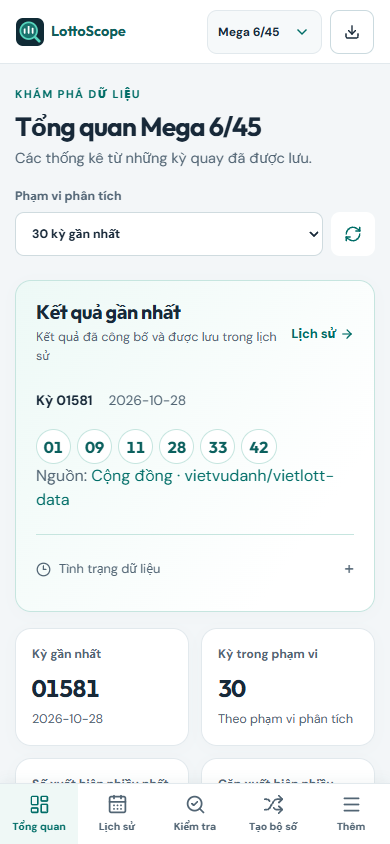

# LottoScope — Vietlott Analytics

Website tra cứu và phân tích **kết quả quay đã công bố** của Lotto 5/35,
Mega 6/45 và Power 6/55: lịch sử, tần suất số/cặp số, khoảng cách xuất hiện,
kiểm tra bộ số và lồng cầu mô phỏng 3D.

**Dùng ngay: [lottoscope-sable.vercel.app](https://lottoscope-sable.vercel.app)**

Không cần cài đặt hoặc đăng nhập. Website online hoạt động khi máy cá nhân tắt.
LottoScope phân tích lịch sử, không dự đoán kỳ tiếp theo hoặc bảo đảm trúng thưởng.

[Dùng online](#hướng-dẫn-dùng-website-online) · [Docker local](#chạy-local-bằng-docker) ·
[Cấu hình cloud](#cấu-hình-bản-online-cho-người-vận-hành) · [Xử lý lỗi](#xử-lý-nhanh-khi-gặp-lỗi)



## Chọn cách sử dụng

| | Website online | Docker trên máy cá nhân |
| --- | --- | --- |
| Phù hợp | Dùng ngay trên máy tính/điện thoại | Tự quản lý dữ liệu, phát triển hoặc chạy trong mạng riêng |
| Cài đặt | Không cần | Docker Desktop có Docker Compose v2 |
| Địa chỉ | [Mở website](https://lottoscope-sable.vercel.app) | `http://127.0.0.1:8088` |
| Dữ liệu | Database cloud đã có lịch sử | Database mới trống, cần nhập lịch sử lần đầu |
| Máy cá nhân tắt | Vẫn truy cập được | Không truy cập được |

Database local và online **độc lập**, không tự đồng bộ dữ liệu với nhau.

## Hướng dẫn dùng website online

1. Mở [LottoScope](https://lottoscope-sable.vercel.app), chọn **Game** ở đầu trang.
2. Trong **Tổng quan**, xem kỳ gần nhất và chọn **Phạm vi phân tích** để thay đổi
   cửa sổ thống kê, chẳng hạn 30 kỳ gần nhất.
3. Dùng menu để khám phá các chức năng bên dưới. Trên điện thoại, menu nằm dưới
   màn hình; **Thêm** mở các mục còn lại.
4. Bấm **Tải dữ liệu** để lấy kỳ mới cho game đang chọn. Chờ hoàn tất và đọc
   thông báo; mỗi game chờ tối thiểu 60 giây giữa hai lượt.

| Chức năng | Cách sử dụng |
| --- | --- |
| **Tổng quan** | Xem kỳ gần nhất, nguồn dữ liệu, các số/cặp xuất hiện nhiều và khoảng cách hiện tại |
| **Lịch sử** | Lọc theo kỳ/ngày, mở chi tiết để xem main/special, nguồn và bảng giải thưởng nếu có |
| **Số** | Xem tần suất và gap dạng lưới, bảng hoặc biểu đồ; chọn một số để xem lịch sử xuất hiện |
| **Cặp số** | Xem tần suất hai số chính cùng xuất hiện và các kỳ chứa cặp đó |
| **Kiểm tra** | Chọn đúng 5 hoặc 6 số chính theo game, bấm **Kiểm tra lịch sử** để xem trùng chính xác và các kỳ tương đồng |
| **Tạo bộ số** | Bấm **Bắt đầu quay** để chạy lồng cầu 3D; có thể tạm dừng, mở phiên mới và gửi bộ số sang trang Kiểm tra |

Lotto 5/35 có 5 số chính (1–35) và special (1–12); Mega 6/45 có 6 số chính
(1–45); Power 6/55 có 6 số chính (1–55) và special khác các số chính.
Analytics và checker chỉ xét **số chính**. Lồng cầu Lotto mô phỏng thêm special
từ lồng riêng 1–12; lồng Mega/Power hiện chỉ quay số chính. Kết quả mô phỏng
không phải kết quả quay chính thức hoặc dự đoán.

### Cập nhật dữ liệu và thời gian chờ

- **Tải dữ liệu** liên hệ nguồn và lưu kỳ mới. **Làm mới hiển thị** chỉ đọc lại
  dữ liệu đã lưu, không yêu cầu nguồn cập nhật.
- Website hiện đồng bộ **thủ công**, không có lịch tự lấy kỳ mới. Dữ liệu có
  thể chậm hơn thời điểm quay; xem ID/ngày kỳ mới nhất và tình trạng đồng bộ.
- Cloud ưu tiên Vietlott. Khi nguồn chính thức trả Cloudflare challenge, hệ
  thống được phép dùng nguồn cộng đồng
  [vietvudanh/vietlott-data](https://github.com/vietvudanh/vietlott-data): đối
  chiếu 20 kỳ gần nhất, kiểm dữ liệu và chỉ thêm kỳ mới liên tiếp. Nguồn cộng
  đồng được ghi rõ trên giao diện; không ghi đè lịch sử cũ.
- Nguồn dự phòng không có bảng giải thưởng/giờ quay. Các thông tin này có thể
  chưa hiển thị; không tự suy hoặc điền giá trị. Nếu fetch/validation thất bại,
  dữ liệu đã lưu vẫn được giữ.
- Render Free có thể ngủ khi không có truy cập. Lần mở đầu có thể mất khoảng
  một phút hoặc lâu hơn; nếu báo backend đang khởi động, chờ rồi tải lại trang.
  Không cần bật máy cá nhân để đánh thức website.

Tại mốc kiểm chứng **30/10/2026**, cloud có Lotto `00976`, Mega `01581` và
Power `01417`. Đây là snapshot nghiệm thu, không phải cam kết latest hiện tại.
Power còn một mục đối soát cũ `01410` bị nguồn chặn; draw vẫn có và các kỳ mới
đã được cập nhật. Xem [kết quả kiểm chứng nguồn](docs/SOURCE_FALLBACK_ACCEPTANCE.md).

### Ảnh minh họa các tính năng

Ảnh chụp từ website online ngày **30/10/2026**, dùng dữ liệu thật đã lưu.
Bộ số trong ảnh Kiểm tra được chọn để minh họa một kỳ đã có trong lịch sử.

<details>
<summary>Xem thống kê số, kiểm tra bộ số, lồng cầu và giao diện điện thoại</summary>

**Thống kê số:** đọc tần suất và khoảng cách xuất hiện theo phạm vi đã chọn.



**Kiểm tra bộ số:** đối chiếu main numbers với dữ liệu lịch sử.



**Lồng cầu mô phỏng:** phiên Lotto 5/35 ở trạng thái sẵn sàng, gồm 5 main và 1 special.



**Trên điện thoại:** chọn game ở đầu trang, chuyển chức năng bằng menu dưới.



</details>

## Chạy local bằng Docker

### 1. Chuẩn bị và cấu hình

Cài Docker Desktop, bật Docker engine và kiểm tra `docker compose version`.
Không cần cài Python, Node.js hoặc PostgreSQL trên host nếu chỉ chạy Docker.
Các lệnh dưới đây dùng **PowerShell tại thư mục gốc repository**.

```powershell
git clone --branch deploy/free-cloud https://github.com/anhkhuong04/LottoScope.git
cd LottoScope
if (-not (Test-Path .env)) {
    Copy-Item .env.example .env
}
```

Nhánh triển khai hiện tại là `deploy/free-cloud`. Repository cần quyền GitHub
phù hợp. Nếu đã có source, mở thư mục dự án trên nhánh này và bỏ
qua hai lệnh đầu. Chỉ copy `.env.example` khi chưa có `.env`; giữ cấu hình hiện
tại nếu đang nâng cấp bản cũ.

Sửa `.env` trước khi khởi động:

| Biến | Cấu hình local |
| --- | --- |
| `POSTGRES_PASSWORD` | Thay `change-me` bằng mật khẩu riêng cho PostgreSQL local |
| `LOTTO_DATABASE_URL` | `postgresql+psycopg://lotto:<password-da-URL-encode>@postgres:5432/lotto`; password phải khớp biến trên |
| `FRONTEND_PORT` | Mặc định `8088`, đổi nếu cổng bận |
| `BACKEND_PORT` | Mặc định `8000`, cổng API trên host |
| `POSTGRES_PORT` | Mặc định `5432`, cổng DB trên host; URL **trong container** vẫn dùng `postgres:5432` |
| `LOTTO_SCHEDULER_ENABLED` | Giữ `false` để đồng bộ thủ công |
| `LOTTO_SOURCE_REQUEST_INTERVAL` | Tùy chọn, mặc định `1.0` giây; có thể tăng lên `2.0`, không được dưới `1.0` |

Giữ `.env` riêng, không commit hoặc chia sẻ connection string. Password có ký
tự đặc biệt phải URL-encode ở URL; `POSTGRES_PASSWORD` giữ giá trị gốc.
Đổi password trong `.env` không tự đổi password của DB đã có trong volume.

### 2. Build, tạo schema và mở ứng dụng

```powershell
docker compose config --quiet
docker compose build backend frontend
docker compose up -d postgres --wait
docker compose run --rm --no-deps -e LOTTO_SCHEDULER_ENABLED=false backend alembic upgrade head
docker compose up -d backend frontend --wait
docker compose ps
Invoke-RestMethod http://127.0.0.1:8000/health/ready
```

Mở **[http://127.0.0.1:8088](http://127.0.0.1:8088)**.
API docs local: [http://127.0.0.1:8000/docs](http://127.0.0.1:8000/docs).
Nếu đổi cổng trong `.env`, dùng cổng mới trong URL kiểm tra/truy cập.

Frontend, API và PostgreSQL mặc định chỉ mở trên loopback của máy chạy Docker.
Trang trống dữ liệu sau lần cài đầu là bình thường: migration chỉ tạo schema,
không tải lịch sử hoặc sao chép database online.

### 3. Nhập lịch sử lần đầu

Nhập game muốn sử dụng, sau khi migration hoàn tất. Ví dụ nhập cả ba game:

```powershell
docker compose run --rm --no-deps -e LOTTO_SCHEDULER_ENABLED=false backend python -m app.commands.import_history --game lotto_535
docker compose run --rm --no-deps -e LOTTO_SCHEDULER_ENABLED=false backend python -m app.commands.import_history --game mega_645
docker compose run --rm --no-deps -e LOTTO_SCHEDULER_ENABLED=false backend python -m app.commands.import_history --game power_655
```

Lệnh lấy lịch sử từ nguồn chính thức; có thể mất nhiều thời gian vì giới hạn
tốc độ và số kỳ. Khi nguồn trả challenge/429, batch dừng và ghi audit; không coi
partial/failed là hoàn tất. Chạy lại cùng lệnh sẽ tiếp tục theo trạng thái đã
lưu, không tạo draw trùng. Nút **Tải dữ liệu** dành cho kỳ mới sau khi đã có
lịch sử/checkpoint; không thay bước nhập lần đầu.

Fallback cộng đồng chỉ áp dụng cho **manual sync opt-in**, cần 20 kỳ tham chiếu
đã lưu; không dùng để khởi tạo DB trống. Compose mặc định chưa truyền
`LOTTO_COMMUNITY_FALLBACK_ENABLED` vào backend: chỉ đổi dòng này trong `.env`
không bật fallback trong container. Có thể opt-in bằng
[Compose override cho local](docs/LOCAL_OPERATIONS.md#bật-fallback-cộng-đồng-cho-manual-sync-local);
giới hạn áp dụng theo [policy](docs/DECISIONS/0012-community-source-fallback.md).

Sau nhập, tải lại giao diện, chọn game và sử dụng như bản online. Dữ liệu bền
vững nằm trong volume PostgreSQL `postgres_data`.

### 4. Dừng, mở lại và cập nhật

```powershell
# Dừng ứng dụng, giữ dữ liệu
docker compose down

# Mở lại sau khi đã cài và migrate
docker compose up -d --wait

# Kiểm tra lỗi
docker compose logs --tail 100 backend frontend postgres
```

**Không dùng `docker compose down -v` nếu muốn giữ dữ liệu.** Local chỉ hoạt
động khi máy và Docker đang chạy. Sau khi tải image và nhập lịch sử, có thể
đọc dữ liệu local đã lưu khi mất mạng; nhập kỳ mới/bổ sung giải chưa lưu cần mạng.

Khi cập nhật source: backup DB, build lại image, chạy migration rồi recreate
backend/frontend theo thứ tự ở bước 2. Source mới hoặc `npm run build` trên
host không tự cập nhật frontend trong container.
Hướng dẫn Wi-Fi, collector Windows, import nâng cao, backup/restore và development
được giữ tại [Vận hành local](docs/LOCAL_OPERATIONS.md).

## Cấu hình bản online cho người vận hành

Bản hiện tại dùng **Vercel Hobby + Render Free + Neon Free**, phục vụ nhu cầu
nhỏ khoảng 10 người; website công khai, không có tài khoản/phân quyền.
Người chỉ truy cập website **không cần tài khoản ba dịch vụ này**.

| Thành phần | Cấu hình chính |
| --- | --- |
| Frontend / gateway — Vercel | Root `frontend`, Node 22.x; server env `LOTTO_API_ORIGIN`, `LOTTO_ORIGIN_TOKEN` |
| API — Render | Docker Free; command `python -m app.commands.serve`; health `/health/live` |
| Render environment | `LOTTO_DEPLOYMENT_MODE=cloud`, Neon direct `LOTTO_DATABASE_URL`, `LOTTO_ORIGIN_TOKEN` khớp Vercel, `LOTTO_SCHEDULER_ENABLED=false`, `LOTTO_COMMUNITY_FALLBACK_ENABLED=true` |
| Database — Neon | PostgreSQL 16, direct TLS URL; không dùng hostname `-pooler.` vì advisory lock theo session |

Không đưa DB URL hoặc origin token vào `VITE_*`/frontend public. Free tier có
giới hạn quota và cold start; không có cam kết SLA hay cập nhật tức thì.
Triển khai mới, thay secrets, migration hoặc rollback theo
[runbook cloud](docs/DEPLOYMENT_FREE.md), không sao chép `.env` local lên cloud.

## Xử lý nhanh khi gặp lỗi

| Hiện tượng | Kiểm tra / xử lý |
| --- | --- |
| Online báo backend đang khởi động | Chờ Render thức rồi tải lại trang; xem trạng thái dịch vụ nếu tiếp tục lỗi |
| Bấm Tải dữ liệu báo phải chờ | Chờ ít nhất 60 giây cho game đó; không bấm liên tục |
| Local chưa có kỳ quay | Hoàn tất migration và nhập lịch sử ở bước 3 |
| Không lấy được kỳ mới / nguồn chặn | Đọc thông báo, giữ dữ liệu cũ; chờ rồi thử lại. Fallback cũng dừng khi dữ liệu không hợp lệ |
| Không có giải thưởng nhưng vẫn xem được số | Kỳ chưa có snapshot giải và nguồn chính thức đang không khả dụng |
| Docker không lên hoặc cổng bị chiếm | Xem `docker compose ps`, logs, `.env` và đổi cổng host nếu cần |
| Sửa source nhưng local vẫn hiện bản cũ | Build lại image liên quan và recreate container; tải lại trình duyệt |
| Lồng cầu chưa sẵn sàng | Chờ tải WebGL/vật lý, dùng trình duyệt có WebGL2; khi lỗi, xem thông báo và thử phiên mới |

## Tài liệu tham khảo

- [Vận hành local & phát triển](docs/LOCAL_OPERATIONS.md): Wi-Fi, CLI, backup/restore, quality gates.
- [Triển khai cloud](docs/DEPLOYMENT_FREE.md), [nghiệm thu cloud](docs/DEPLOYMENT_ACCEPTANCE.md), [nghiệm thu fallback](docs/SOURCE_FALLBACK_ACCEPTANCE.md).
- [Kiến trúc](docs/ARCHITECTURE.md), [API](docs/API.md), [pipeline và nguồn dữ liệu](docs/DATA_PIPELINE.md), [data model](docs/DATA_MODEL.md).
- [Domain](docs/DOMAIN.md), [analytics](docs/ANALYTICS.md), [lồng cầu mô phỏng](docs/DRAW_SIMULATION.md).
- [Design system](docs/DESIGN_SYSTEM.md), [nghiệm thu UI](docs/UI_REFRESH_ACCEPTANCE.md), [nghiệm thu MVP](docs/MVP_ACCEPTANCE.md), [Power](docs/POWER_ACCEPTANCE.md).

Strategy management, backtesting, random baseline và saved picks thuộc Phase 2,
chưa phải chức năng hiện có. Dự án không mua vé tự động hoặc đưa ra cam kết sinh lời.
