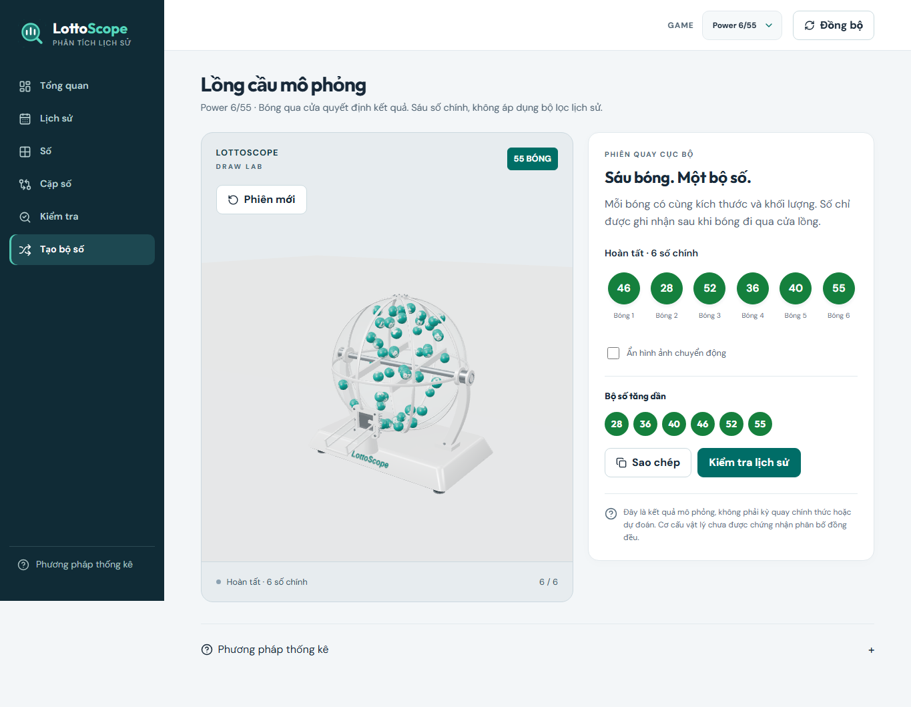

# Thiết kế lại lồng cầu

Ngày 03/11/2026: người dùng duyệt mẫu từ `lc1.png`/`lc2.png`, yêu cầu **chỉ giữ
phối cảnh 3D**, tích hợp Rapier và cập nhật Docker local. Không deploy cloud.
Quy tắc kết quả và chi tiết vật lý ở [DRAW_SIMULATION](DRAW_SIMULATION.md).

## Phân tích và lựa chọn

Bản cũ dùng khung dây, cửa đáy và capture theo trục Y. Mẫu tham chiếu có
vỏ acrylic, khung trắng, cửa trước thấp và máng nhô ra; chỉ đổi mesh sẽ khiến
cửa nhìn thấy và cửa vật lý khác nhau. Bản tĩnh đã được duyệt trước khi sửa
collider; ảnh mốc tĩnh lưu tại `images/screenshots/machine-preview-static.png`.

Chọn geometry tham số của Three.js để tận dụng stack hiện có, không thêm
dependency/model GLB. Vỏ và gối đỡ đứng yên; trục/cánh khuấy quay bên trong.
Phễu trong, gate và cổ thoát có collider riêng. Khung trang trí/đế/máng ngoài
không tham gia xác định kết quả. Acrylic dùng alpha/clearcoat để giảm chi phí,
chưa tái tạo khúc xạ quang học như ảnh render tham chiếu.

## Cấu trúc triển khai

Trong `frontend/src/features/draw-machine/`:

| Module | Trách nhiệm |
| --- | --- |
| `DrawMachine.tsx` | Điều khiển phiên, kết quả, copy/checker, lỗi và retry |
| `DrawScene.tsx` | Đồng bộ body → instanced mesh, gate/rotor, Canvas/Physics |
| `config.ts` | Kích thước, thông số vật lý và hệ tọa độ cửa dùng chung |
| `physics.ts` | Collider độc lập với visual, khuấy, crossing, pause/stall/cleanup |
| `session.ts` | Main → special của Lotto; giữ kết quả hai pool tách biệt |
| `visual/MachineModel.tsx`, `MachineHardware.tsx`, `geometry.ts` | Vỏ, khung, trục, gate, máng và đế |
| `visual/BallPool.tsx` | Bóng teal/số trắng, một atlas/material/instanced mesh |
| `visual/Studio.tsx`, `camera.ts`, `design.ts` | Phối cảnh cố định, ánh sáng/environment cục bộ, cấu hình vật liệu |

`/generator` dùng trực tiếp mô hình mới. URL `/generator/preview` chuyển về
generator, giữ query game/window; bỏ editor, cutaway và các nút front/right/top.
Bóng trong máy dùng teal; ô kết quả main/special vẫn xanh lá/đỏ chữ trắng.
Không đổi count/game, checker/API/schema hoặc ghi kết quả mô phỏng vào lịch sử.

## Hiệu suất và lỗi

- Instancing/atlas, tài nguyên tái sử dụng và dispose khi hủy; không setState
  vị trí mỗi frame. Scene/Rapier lazy-load, không HDR/CDN runtime.
- DPR tối đa 1.5, màn hình nhỏ 1; render demand khi nghỉ/tạm dừng. Camera căn
  đủ máy/máng theo aspect, không tự xoay. Physics bước cố định 1/60 giây.
- Thiếu WebGL/WASM, shader lỗi hoặc mất context có thông báo/retry và hình
  minh họa. Không sinh số thay thế. Giữ reduced motion, pause khi ẩn tab,
  reset và hủy phiên khi chuyển game.

## Kiểm chứng

Tiến độ và kết quả thực chạy ở
[DRAW-VIS-02](superpowers/plans/2026-11-03-draw-machine-integration.md).
Chỉ bản Docker local được cập nhật trong mốc này; bản online độc lập.
