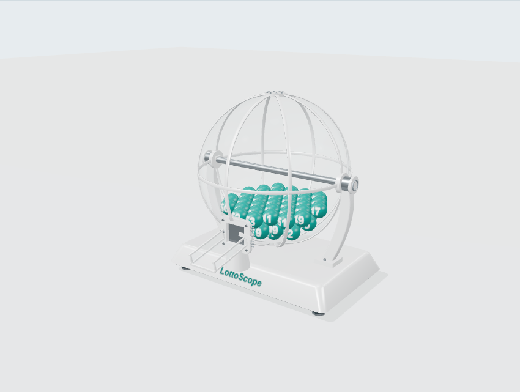

# Thiết kế lại lồng cầu — bản xem trước

Ngày: 03/11/2026. Trạng thái: **bản tĩnh hoàn tất, chờ người dùng duyệt**.
Tham chiếu: `frontend/public/references/lc1.png`, `lc2.png` do người dùng cung cấp.
Contract quay hiện hành vẫn ở [DRAW_SIMULATION.md](DRAW_SIMULATION.md).

## 1. Phân tích source hiện tại

| Thành phần | Trách nhiệm / điểm cần lưu ý |
| --- | --- |
| `DrawMachine.tsx` | UI phiên, lazy-load, WebGL/error boundary, pause khi ẩn tab, copy/checker |
| `DrawScene.tsx` | Canvas, lồng dây trang trí, cập nhật mesh từ body; chưa có acrylic, vật liệu/kích thước phần lớn hard-code |
| `physics.ts` | Collider shell rỗng đứng yên, cổ thoát đáy, gate; lực khuấy không phụ thuộc số; capture theo vượt mặt phẳng |
| `session.ts` | Đủ main mới chuyển Lotto sang pool special; giữ kết quả riêng |

Visual và collider đã khác object, nhưng visual đọc hằng số physics và nằm chung
scene/controller. Trục trang trí hiện không làm lồng collider quay. Capture hiện
ở `y=-3.05`, hướng xuống; ảnh là cửa trước thấp và máng nghiêng ra trước.
Không thể chỉ chuyển hình cửa ra trước rồi tuyên bố khớp collider.
Bóng đã capture hiện được nội suy tới khay, không tiếp tục lăn vật lý trên máng.

## 2. Phương án và cấu trúc đề xuất

Chọn **geometry tham số bằng Three.js** cho bản duyệt: dễ chỉnh theo ảnh và
không cần asset/Blender hoặc dependency mới. GLB có lợi khi cần chi tiết chế tạo
chính xác nhưng cần pipeline model/LOD; sửa trực tiếp Cage hiện tại sẽ tiếp tục
ghép visual với controller và khó đối chiếu cửa/collider.

Trong `frontend/src/features/draw-machine/preview/`:

- `design.ts`: cấu hình visual, vị trí bóng tĩnh hợp lệ; không import Rapier/session.
- `geometry.ts`: vỏ có lỗ cửa, dải khung, đế; vòng đời BufferGeometry tách biệt.
- `MachineModel.tsx` + `MachineHardware.tsx`: khung trắng, trục/gối đỡ, cổng,
  hatch, máng acrylic, đế/chân; tọa độ thiết kế dùng tâm cầu làm gốc.
- `BallPool.tsx`: bóng teal, số trắng dùng chung atlas và instancing.
- `PreviewScene.tsx`: studio light/environment cục bộ, camera/OrbitControls,
  render theo yêu cầu, context-loss cleanup; không physics world.
- `camera.ts`: căn đủ khung cầu/đế/máng theo aspect và góc nhìn, chừa kích thước
  tối đa 125%; tránh cắt chân đế ở mobile hoặc khi đổi preset.
- `MachinePreview.tsx`: trang `/generator/preview`, góc nhìn bằng nút, cutaway,
  trạng thái cửa, vật liệu/kích thước/chất lượng và fallback khi thiếu WebGL.

Mô hình không tự quay, không tạo kết quả hoặc nút copy/checker. Vị trí bóng là
bố trí tĩnh minh họa, không phải trạng thái Rapier đã settle. Preview dùng teal
theo yêu cầu mới; UI kết quả/analytics tiếp tục màu theo Design System.

## 3. Cấu hình và hiệu suất

- Mốc này: bán kính/kích thước toàn máy, màu khung/bóng/số, độ trong acrylic,
  quality và góc nhìn. Các tỷ lệ cơ khí cùng đổi theo kích thước.
- Bóng dùng một texture atlas/material/instanced mesh; geometry/material tái sử dụng,
  dispose khi đổi cấu hình/rời trang. Không setState mỗi frame, không HDR/CDN runtime.
- Canvas `frameloop="demand"`; OrbitControls không auto-rotate/damping. DPR giới
  hạn 1–1.5; chế độ tiết kiệm giảm segments/shadow/texture. Acrylic alpha là
  xấp xỉ để rõ bóng và tránh chi phí nhiều lớp transmission; không hứa photoreal.
- Loading/error/retry và hình minh họa fallback, điều khiển góc nhìn bằng nút
  cho keyboard/touch. WebGL/context-loss không được sinh kết quả thay thế.

Nguồn kỹ thuật: [R3F on-demand/resources](https://r3f.docs.pmnd.rs/advanced/scaling-performance),
[Three physical material](https://threejs.org/docs/pages/MeshPhysicalMaterial.html),
[OrbitControls](https://threejs.org/docs/pages/OrbitControls.html).

## 4. Phần chờ duyệt, chưa triển khai

Sau khi duyệt mô hình, chốt đường thoát/capture và phần nào thực sự quay.
Đề xuất collider riêng cho shell rỗng, gate, throat/chute; không dùng mesh
trang trí làm collider và không xoay collider lỗ thoát mà giữ capture cũ.
Cấu hình motion/physics lúc đó gồm tốc độ trục (rad/s), stirring, gravity,
mass, restitution, friction, damping, CCD và fixed step; mọi bóng cùng tham số.
Phải giữ nguyên “bóng qua cửa quyết định số”, thứ tự/kết thúc phiên và game rules.
Thay đổi bất kỳ cơ chế hiện hành nào cần lý do kỹ thuật và phê duyệt riêng.

Bước 5 sau tích hợp: kiểm va chạm, cửa đóng/mở, crossing, kẹt, đủ main/special,
pause/reset/game switch, hiệu năng thiết bị thật và mất context. Bản tĩnh
không chứng minh các acceptance vật lý này.

## 5. Xem bản tĩnh và kiểm chứng

Chạy frontend dev theo [LOCAL_OPERATIONS](LOCAL_OPERATIONS.md); mở
`/generator/preview?game=lotto_535` hoặc **Tạo bộ số → Xem thiết kế lồng cầu mới**.
Chọn game để thay pool 35/45/55, bốn góc nhìn hoặc kéo orbit; mở vỏ/cửa và chỉnh
kích thước, độ hiện acrylic, màu khung/bóng/số, chất lượng. Không tự quay.

- Lint, format, typecheck, build đạt; **80 unit tests**, gồm 4 ca bố trí/validation
  và 12 ca camera với mẫu hình học độc lập. Các test Rapier/session cũ vẫn chạy.
- **9 E2E preview pass** trên desktop/tablet/mobile: điều khiển/config/reset,
  game switch, axe, không overflow; không tải Rapier/WASM hoặc gọi generate/sync;
  WebGL không hỗ trợ có SVG fallback, mất context có thể thử lại.
- **4 E2E hồi quy pass** cho mô phỏng hiện hành: quay Lotto 5+1, Mega/Power 6
  main, copy/handoff checker và trạng thái thiếu WebGL/reduced motion.
- Đã rà ảnh front/right/top/isometric/cutaway/mobile. Acrylic là xấp xỉ alpha,
  không khúc xạ như ảnh render tham chiếu; bóng là bố trí tĩnh, không phải kết quả.
- Build còn cảnh báo chunk lớn và Three.js có deprecation warning hiện hữu.
  Chưa đo FPS trên thiết bị thật; không tuyên bố đạt nghiệm thu vật lý của bước 5.
- Không sửa backend/DB, physics/session hay quy tắc xác định kết quả. Chưa push,
  deploy hoặc rebuild Docker; trang Docker/online vẫn là bundle cũ.
